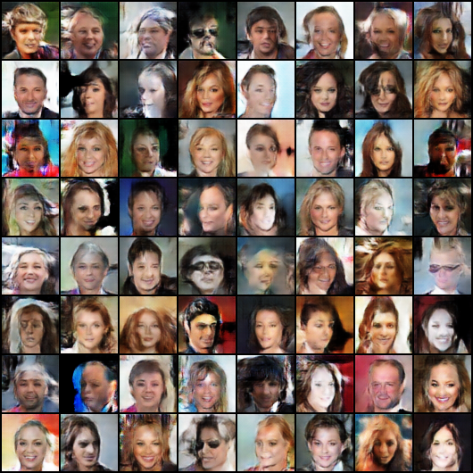
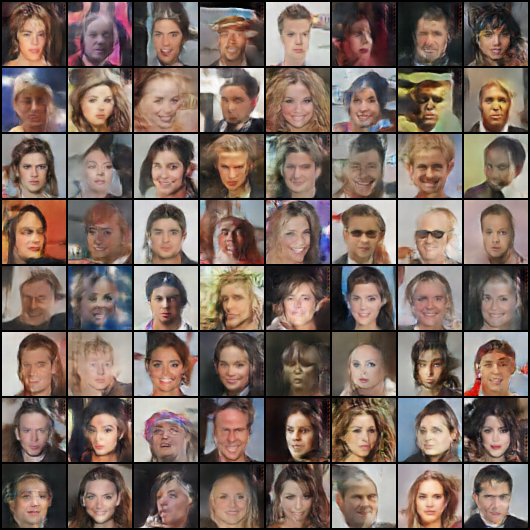
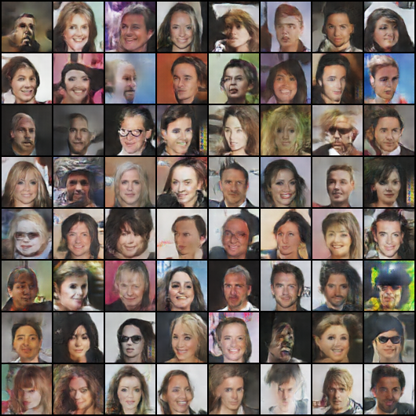
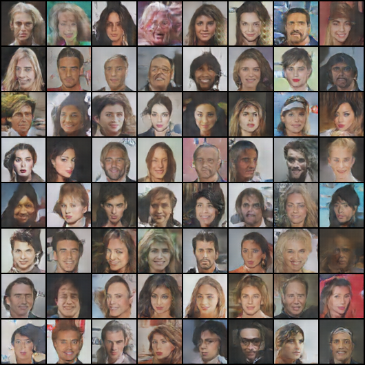
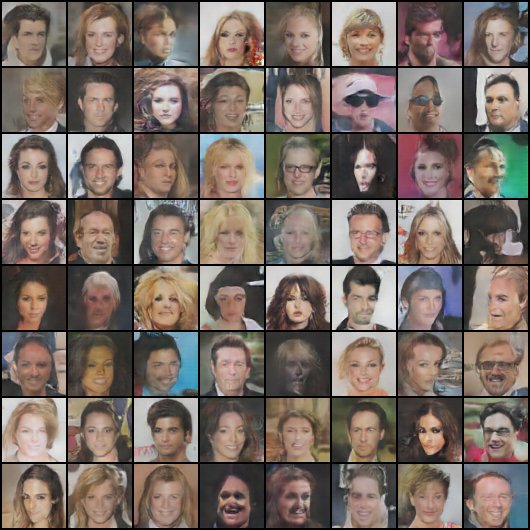
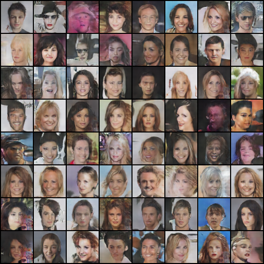
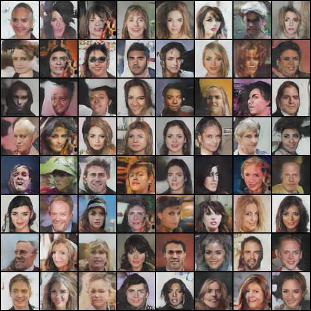
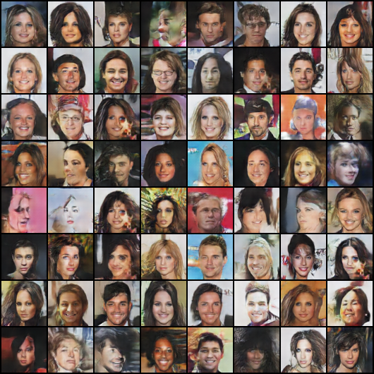
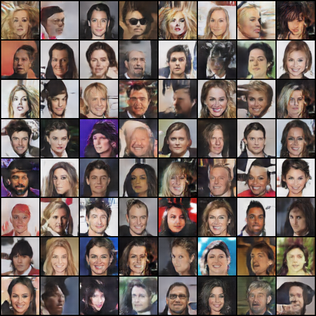
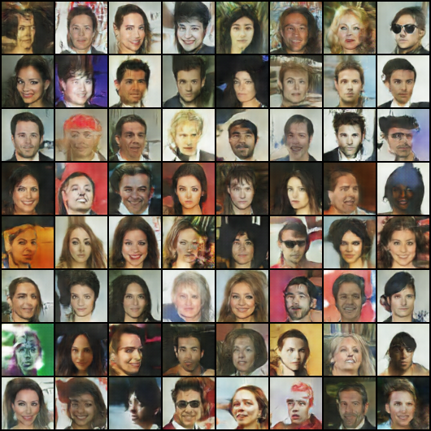

# Sequence Modeling with RNN/LSTM and Image Generation with DCGAN

A two-part deep learning project covering **human activity recognition** with recurrent neural networks and **realistic image generation** with a Deep Convolutional Generative Adversarial Network (DCGAN). Both experiments are implemented in the accompanying Jupyter notebook.

- **Part 1 — Sequence Modeling:** Compare a Simple RNN and an LSTM on six-class Human Activity Recognition (HAR).
- **Part 2 — Generative Modeling:** Train a DCGAN on the CelebA face dataset, visualize generation across 50 epochs, and evaluate generated samples.

## Project Overview

| Component | Dataset | Framework | Goal |
|---|---|---|---|
| Part 1: RNN and LSTM | Human Activity Recognition (HAR) | TensorFlow / Keras | Classify six activities |
| Part 2: DCGAN | CelebA (202,599 face images) | PyTorch / Torchvision | Generate 64 × 64 RGB face images |

## Repository Contents

```text
Sequence-Modeling-with-RNN-and-LSTM/
├── README.md
├── Sequence Modeling with RNNLSTM.ipynb
├── epoch_5.png
├── epoch_10.png
├── epoch_15.png
├── epoch_20.png
├── epoch_25.png
├── epoch_30.png
├── epoch_35.png
├── epoch_40.png
├── epoch_45.png
└── epoch_50.png
```

> The image paths above match the current repository screenshot, where the PNG files are in the repository root. If you later move them into a real `Results/` directory, change each README image link from `epoch_5.png` to `Results/epoch_5.png` (and likewise for the other epochs). The training notebook originally writes these grids to `samples/` in its runtime environment.

---

## Part 1 — Sequence Modeling with RNN and LSTM

### 1. Dataset and Preprocessing

The notebook loads the HAR `train.csv` and `test.csv` files and predicts one of six activities:

`LAYING`, `SITTING`, `STANDING`, `WALKING`, `WALKING_DOWNSTAIRS`, or `WALKING_UPSTAIRS`.

Preprocessing includes label encoding and standardization using statistics fitted on the **original training CSV, not the test CSV**. The notebook then creates an 80/20 training/validation split. Because scaling is fitted before this split, the validation examples influence the scaler statistics; a stricter validation protocol would fit the scaler on the final training subset only.

| Dataset split | Samples |
|---|---:|
| Training | 5,881 |
| Validation | 1,471 |
| Test | 2,947 |

**Important methodological limitation:** The input CSV contains engineered HAR features rather than raw sensor windows. Because the 562 input features cannot be reshaped to the notebook's preferred sequence lengths, the code falls back to `(samples, 1, 562)`. Thus, the RNN and LSTM process **one timestep per example**; this experiment compares recurrent architectures as classifiers but does not meaningfully test learning long-range temporal dependencies.

### 2. Model Architectures

Both classifiers use the same prediction head:

- Recurrent layer: **128 units** (`SimpleRNN` or `LSTM`)
- Dropout: **0.3**
- Fully connected layer: **64 units**, ReLU activation
- Dropout: **0.3**
- Output: **6-unit softmax** classifier

### 3. Training Configuration

Both models are trained for **20 epochs**, with batch size **64**, Adam learning rate **0.001**, and sparse categorical cross-entropy loss. Training and validation accuracy curves are generated in the notebook.

### 4. Test Results

The notebook reports the following **weighted-average** classification metrics on the held-out test set:

| Model | Accuracy | Precision | Recall | F1-score |
|---|---:|---:|---:|---:|
| LSTM | 93.99% | 94.49% | 93.99% | 93.99% |
| Simple RNN | **94.33%** | **94.58%** | **94.33%** | **94.34%** |

The Simple RNN achieved slightly higher test performance in this run. The notebook also includes classification learning curves and confusion matrices for both models.

---

## Part 2 — Generative Modeling with DCGAN

### Objective

Build and train a **Deep Convolutional Generative Adversarial Network (DCGAN)** to generate new 64 × 64 RGB face images resembling the CelebA training data. The generator creates images from random latent vectors, while the discriminator learns to distinguish real face images from generated ones.

### Task 1 — Dataset and Preprocessing

The implementation uses **CelebA**, a public facial-image dataset. The executed notebook reports:

| Split | Images |
|---|---:|
| Full dataset | 202,599 |
| Training (80%) | 162,079 |
| Test (20%) | 40,520 |

The PyTorch pipeline uses `ImageFolder` with:

1. Resize images to **64 pixels** on the shorter side.
2. Apply a **64 × 64 center crop**.
3. Convert images to tensors.
4. Normalize RGB channels using mean and standard deviation of `0.5`, producing values approximately in **[-1, 1]** to match the generator's `Tanh` output.
5. Create disjoint training and test subsets using `random_split` and load batches of **128** images.

The test split is created in the code, but the current GAN evaluation samples real images from the **training loader**, not the test loader. The GAN split also lacks a fixed random seed in its current implementation.

### Task 2 — GAN Architecture

#### Generator (G)

The generator maps a **100-dimensional** noise vector, sampled from a standard normal distribution, into a synthetic RGB image.

```text
Random noise z ~ N(0, I), shape (100, 1, 1)
             ↓
ConvTranspose2d → BatchNorm → ReLU    (512 × 4 × 4)
             ↓
ConvTranspose2d → BatchNorm → ReLU    (256 × 8 × 8)
             ↓
ConvTranspose2d → BatchNorm → ReLU    (128 × 16 × 16)
             ↓
ConvTranspose2d → BatchNorm → ReLU    (64 × 32 × 32)
             ↓
ConvTranspose2d → Tanh                (3 × 64 × 64)
```

#### Discriminator (D)

The discriminator receives a real or generated **3 × 64 × 64** image and produces a **single real/fake logit**:

```text
RGB image (3 × 64 × 64)
             ↓
Conv2d → LeakyReLU(0.2)                (64 × 32 × 32)
             ↓
Conv2d → BatchNorm → LeakyReLU(0.2)    (128 × 16 × 16)
             ↓
Conv2d → BatchNorm → LeakyReLU(0.2)    (256 × 8 × 8)
             ↓
Conv2d → BatchNorm → LeakyReLU(0.2)    (512 × 4 × 4)
             ↓
Conv2d                                     (1 logit)
```

The discriminator deliberately has **no sigmoid layer** because the training objective is `BCEWithLogitsLoss`, which incorporates the sigmoid calculation.

### Task 3 — Training

| Parameter | Value |
|---|---|
| Framework | PyTorch |
| Epochs | **50** |
| Batch size | **128** |
| Latent dimension | **100** |
| Optimizer (G and D) | Adam |
| Learning rate | **0.0002** |
| Adam beta values | **(0.5, 0.999)** |
| Loss | `BCEWithLogitsLoss` |
| Hardware | CUDA GPU if available, otherwise CPU |
| Generated-image snapshots | Every **5 epochs** |

**Alternating optimization:** For every training batch, the discriminator is updated using real images and detached generator outputs, followed by a generator update that encourages the discriminator to classify generated images as real. The notebook prints the generator and discriminator's final minibatch losses after every epoch.

An **8 × 8 grid of 64 generated faces** is saved every five epochs. The notebook creates a fresh noise sample for each grid, so the epoch images illustrate overall generation progress rather than changes to the exact same fixed latent vectors.

### Task 4 — Results: Generated Images Across 50 Epochs

The following sample grids were produced at five-epoch intervals during GAN training.

| Epoch 5 | Epoch 10 |
|:---:|:---:|
|  |  |

| Epoch 15 | Epoch 20 |
|:---:|:---:|
|  |  |

| Epoch 25 | Epoch 30 |
|:---:|:---:|
|  |  |

| Epoch 35 | Epoch 40 |
|:---:|:---:|
|  |  |

| Epoch 45 | Epoch 50 |
|:---:|:---:|
|  |  |

### GAN Evaluation

**Qualitative evaluation:** The notebook visualizes a row of CelebA images beside a row of generated images, allowing a visual comparison of faces and image appearance. The real images are still normalized to `[-1, 1]` when plotted, which causes Matplotlib clipping warnings. For a fair visual comparison, both image groups should first be converted consistently to `[0, 1]`.

**Quantitative evaluation:** The notebook computes Fréchet Inception Distance (FID) using `pytorch-fid` and prints:

> **Preliminary FID: 127.52 (not a valid benchmark)**

This value is **not reliable as a formal FID score**, because the evaluation code takes only 64 real images and 64 generated images, repeats each group to fill folders of 500 files, and saves the real images without undoing their `[-1, 1]` normalization. For an interpretable FID result, the project should use **independent, non-repeated samples** from held-out real data and generated outputs, with both groups saved to the correct image range and evaluated using the same pipeline.

The checkpoint-saving cell writes model weights to `saved_models/generator.pth` and `saved_models/discriminator.pth` in the notebook runtime. These checkpoint files are **not included** in the repository structure shown above.

---

## How to Run

The notebook was written for **Google Colab**. A GPU runtime is recommended for DCGAN training.

1. Open [`Sequence Modeling with RNNLSTM.ipynb`](Sequence%20Modeling%20with%20RNNLSTM.ipynb) in Google Colab or Jupyter.
2. Install the libraries used in the notebook (if not already installed):

   ```bash
   pip install numpy pandas scikit-learn matplotlib seaborn tensorflow torch torchvision pytorch-fid joblib
   ```

3. **For Part 1:** Upload the HAR `train.csv` and `test.csv` files into the notebook's working directory, then run the Part 1 cells.
4. **For Part 2:** Upload the CelebA ZIP file to Google Drive. The notebook currently expects it at `/content/drive/MyDrive/archive (3).zip`, extracts it under `/content/celeba`, and loads images using `ImageFolder(root='/content/celeba')`. Adjust these paths if your files are elsewhere.
5. Run the cells under **Part 2: Generative Modeling with Generative Adversarial Networks (GANs)** in order. Part 2 can be executed independently of Part 1 after its dataset and dependencies are prepared.
6. After training, inspect image grids saved under `samples/` and model weights under `saved_models/` in the runtime. Save these files to persistent storage if you need to retain them after the Colab session ends.

> **Data availability:** The HAR CSVs and CelebA image archive are not bundled with this repository. Download them separately and respect their respective dataset usage terms.

## Limitations and Next Steps

- **Sequence modeling:** Use raw HAR sensor windows with multiple timesteps for a meaningful evaluation of temporal dynamics. The present feature-based model operates on a single timestep. Refit the scaler after separating training and validation subsets to avoid validation-set influence.
- **GAN evaluation:** Correct image denormalization, use non-duplicated samples, and compute FID against genuinely held-out real images.
- **GAN reproducibility:** Seed the dataset split, log an average loss across all training batches, and save epoch grids using a fixed latent-noise batch to make visual comparison more controlled.
- **Experiment artifacts:** Consider saving selected training curves, corrected real-vs-fake comparisons, and portable model checkpoints alongside the README.

## Technologies

**Python · Jupyter Notebook / Google Colab · TensorFlow · Keras · PyTorch · Torchvision · NumPy · Pandas · scikit-learn · Matplotlib · Seaborn · pytorch-fid**

---

**Repository:** [humairyousaf6/Sequence-Modeling-with-RNN-and-LSTM](https://github.com/humairyousaf6/Sequence-Modeling-with-RNN-and-LSTM)
